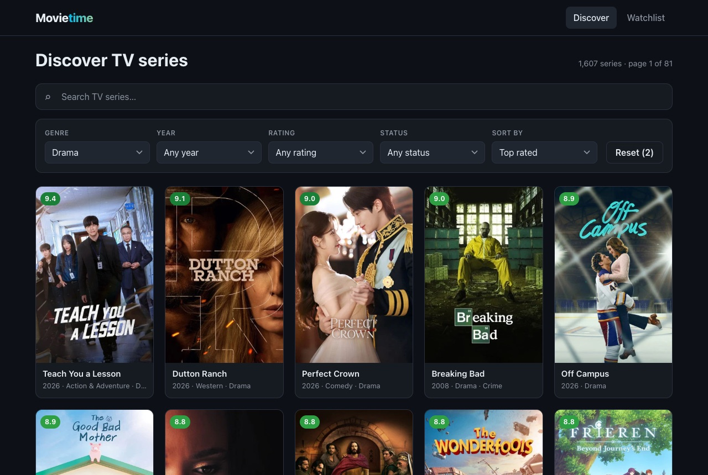
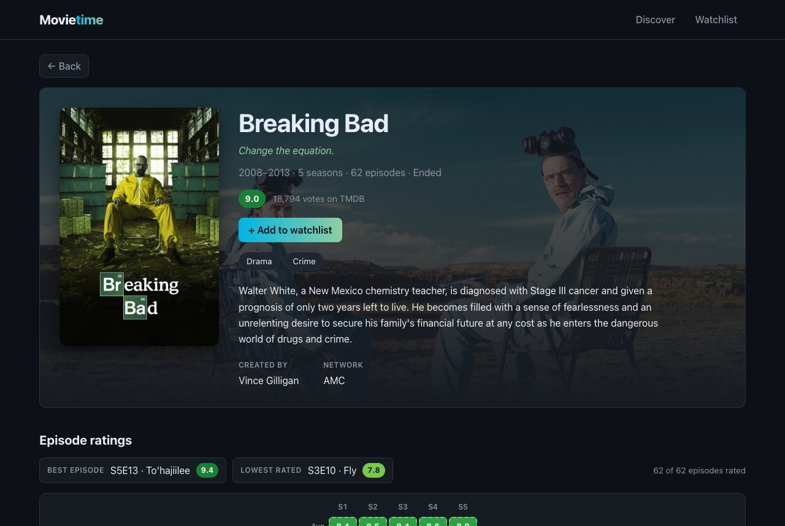
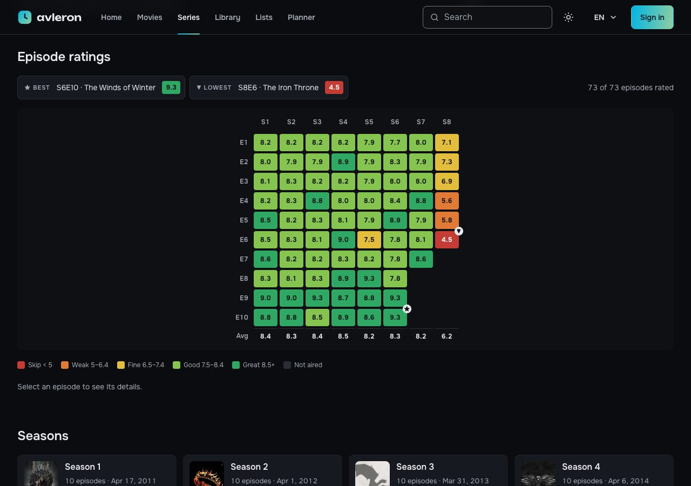
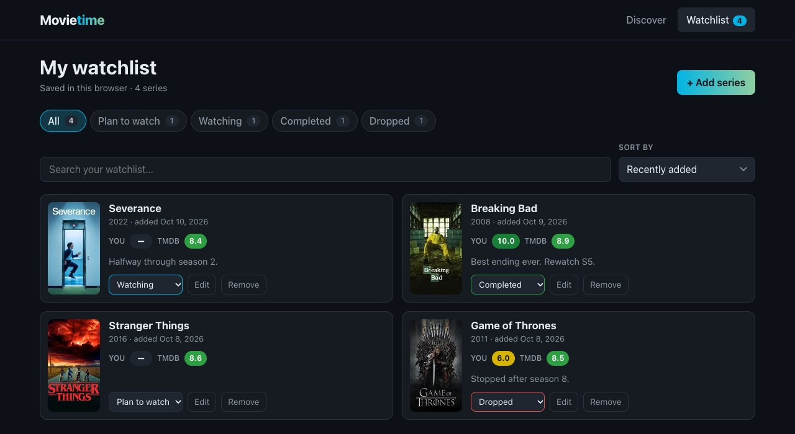
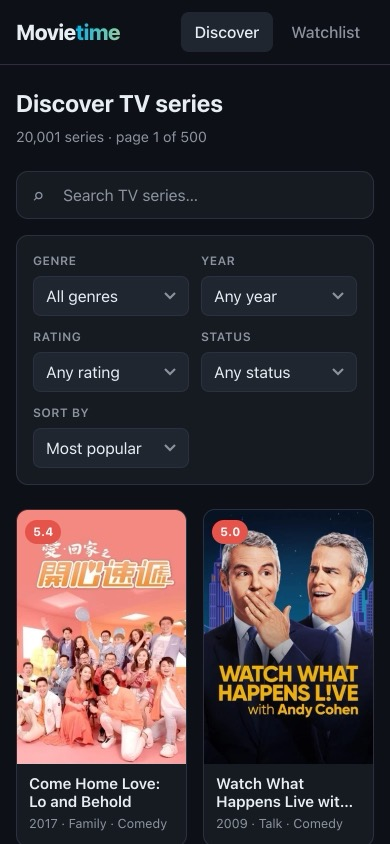

# Movietime

Plan what to watch, and watch it together.

Movietime is a React single-page application for movies and TV series. You discover titles
from [TMDB](https://developer.themoviedb.org/docs), see how every episode of a series is rated,
keep a personal library, collect titles into lists, and turn a series or a list of movies into
a **watch schedule** on a calendar. Lists and schedules can be shared with friends by link or
with an editor / viewer role.

**Live demo:** https://react-movietime.vercel.app

> React end-term project (KBTU), built on top of the midterm version.
> **Status:** midterm features are done. End-term features are in progress; see the
> [roadmap](docs/PROJECT_PLAN.md#5-roadmap).



## Features

Legend: ✅ implemented, 🚧 in progress.

### Catalog

- ✅ **Movies and series catalogs** (one page, switched by a Movies/Series control) with
  server-side search (debounced), five filters (genre, year, minimum rating, original language,
  plus runtime for movies or status for series), five sort orders, pagination and a page size of
  20 / 40 / 60. Everything lives in the URL, so links can be shared and back/forward works.
- ✅ **Series page**: overview, seasons, trailer, cast and recommendations.
- ✅ **Episode ratings heatmap**: every episode of every season colored by its TMDB rating,
  with season averages, best and lowest episode, and an episode panel.
- ✅ **Movie page**: overview, director, budget, revenue, runtime, release date, trailer, cast
  and recommendations.

### Personal data

- ✅ **Authentication**: email/password with validation and email verification, Google
  sign-in, persistent session, protected routes.
- ✅ **Library** (the midterm watchlist, now for movies and series): status, score 1–10, notes
  and episode progress for each title; status tabs with counts, search, type, genre and sort in
  the URL, rows or poster grid, undo for changes and removals. Guests keep it in `localStorage`
  (synced across tabs), signed-in users in Firestore in real time. On sign-in the guest library
  is merged into the account, and the midterm watchlist is moved into it once.
- ✅ **Lists**: named collections of movies and series with an emoji cover and a poster
  collage; create, rename, delete with confirm; add titles from a search picker, from a title
  page or a catalog card; per-title notes; remove with undo. Stored in Firestore, live.
- ✅ **Sharing**: share a list by link (read-only, works for guests) or add friends by email
  as **editor** or **viewer**; change roles, remove access with undo, leave a list, copy a
  shared list to your own. "Shared with me" on the Lists and Home pages. Access is enforced by
  Firestore security rules (member access needs a verified email). Plans are shared the same
  way.
- ✅ **Watch Planner**: turn a series (from your last watched episode, the start or any episode)
  or a list of movies into viewing sessions on the weekdays and time you pick, with a live
  preview of sessions, hours and the finish date. Month calendar (agenda on phones), "Today"
  with _Mark as watched_, plans by week with mark / reschedule (optionally shifting later
  sessions) / skip / undo, `.ics` export, sharing with editors and viewers. Marking a session
  moves your library progress and completes the title on the last one. "Up next" on Home and a
  "Tonight" chip in the header.
- ✅ **Dashboard**: six statistics (titles, completed, average score, hours watched, sessions
  this week, active plans) and four breakdowns (status, top genres, movies vs series, sessions
  by weekday) for all time, 30 days or this year (`?period=`). Tiles and bars open the library
  with the same filter; upcoming sessions open their plan. Works for guests from the local
  library.
- ✅ **Profile**: account info, counters, activity feed; settings for name, theme and language ✅
- ✅ **Languages**: English, Русский, Қазақша from the header menu or settings; the choice is saved in the account, applies without a reload and is sent to TMDB (`language=ru-RU`)
  (synced with the account).

### App

- ✅ Loading skeletons, error states with retry, empty states, responsive layout.
- ✅ Light / dark theme that follows the system by default, with a toggle in the header.
- 🚧 English / Russian / Kazakh (also for TMDB content).
- 🚧 Installable PWA with offline support.

| Series page                                     | Episode ratings                                  |
| ----------------------------------------------- | ------------------------------------------------ |
|  |  |

| Watchlist                                    | Mobile                                        |
| -------------------------------------------- | --------------------------------------------- |
|  |  |

## Tech stack

- **React 19** + **TypeScript** (strict) + **Vite**, **React Router** (declarative mode)
- **Redux Toolkit**: global state; `preferences` with listener middleware ✅, `auth` ✅, `library` ✅
- **Firebase**: Authentication (email/password, Google), Cloud Firestore
- **TMDB API** for movies and series
- **CSS Modules** on design tokens (`styles/tokens.css`), dark and light themes via `data-theme`
- Plain `fetch` + custom hooks for TMDB, `onSnapshot` + custom hooks for Firestore
- `i18next` + `react-i18next`: en / ru / kk, dictionaries are JSON files in `public/locales/`, split by feature and loaded on demand ✅
- 🚧 **Service worker** written with Workbox (`vite-plugin-pwa`, `injectManifest` mode)
- 🚧 **Vitest** + **React Testing Library**
- **ESLint** (`typescript-eslint`) + **Prettier**

## Getting started

Requirements: Node.js 20+, a free
[TMDB API Read Access Token](https://www.themoviedb.org/settings/api) and a Firebase project
(see [docs/FIREBASE_SETUP.md](docs/FIREBASE_SETUP.md)).

```bash
git clone https://github.com/EraEKV/react_movietime.git
cd react_movietime
npm install
cp .env.example .env.local   # fill in the values, see below
npm run dev
```

| Script                 | Description                                  |
| ---------------------- | -------------------------------------------- |
| `npm run dev`          | Start the dev server                         |
| `npm run build`        | Type-check, then production build to `dist/` |
| `npm run typecheck`    | Type-check with `tsc -b`                     |
| `npm run preview`      | Serve the production build                   |
| `npm run lint`         | Lint with ESLint                             |
| `npm run format`       | Format with Prettier                         |
| `npm run format:check` | Check formatting                             |

### Environment variables

| Name                                | Required | Description                                    |
| ----------------------------------- | :------: | ---------------------------------------------- |
| `VITE_TMDB_TOKEN`                   |   yes    | TMDB API Read Access Token (sent as Bearer)    |
| `VITE_FIREBASE_API_KEY`             |   yes    | Firebase web app config                        |
| `VITE_FIREBASE_AUTH_DOMAIN`         |   yes    | `<project-id>.firebaseapp.com`                 |
| `VITE_FIREBASE_PROJECT_ID`          |   yes    |                                                |
| `VITE_FIREBASE_STORAGE_BUCKET`      |   yes    |                                                |
| `VITE_FIREBASE_MESSAGING_SENDER_ID` |   yes    |                                                |
| `VITE_FIREBASE_APP_ID`              |   yes    |                                                |
| `VITE_FIREBASE_MEASUREMENT_ID`      |    no    | Only for Google Analytics, not used by the app |

`.env.local` is git-ignored. All of these values end up in the client bundle, which is
expected: the TMDB read token is read-only and rate-limited, and the Firebase web config only
identifies the project. User data is protected by Firestore security rules.

## API documentation

Full reference: **[docs/API.md](docs/API.md)** (service functions) and
**[docs/DATA_MODEL.md](docs/DATA_MODEL.md)** (schemas, security rules, indexes).

### Resources

| Resource                | Backend                                  | Operations                                                                   |
| ----------------------- | ---------------------------------------- | ---------------------------------------------------------------------------- |
| Titles (movies, series) | TMDB REST                                | List with search, filters, sort, paging; details by id; seasons and episodes |
| Library entries         | Firestore `users/{uid}/library`          | Create, read, update, delete (owner only)                                    |
| Lists + items           | Firestore `lists`, `lists/{id}/items`    | Full CRUD; shared by link or roles                                           |
| Plans + sessions        | Firestore `plans`, `plans/{id}/sessions` | Generate, complete, reschedule, skip, delete                                 |
| Profile, activity       | Firestore `users/{uid}`                  | Read, update                                                                 |

### TMDB endpoints

| Endpoint                                                                                | Used for           |
| --------------------------------------------------------------------------------------- | ------------------ |
| `GET /discover/tv`, `GET /discover/movie`                                               | Catalogs           |
| `GET /search/tv`, `GET /search/movie`                                                   | Search             |
| `GET /tv/{id}`, `GET /movie/{id}` + `append_to_response=credits,videos,recommendations` | Details            |
| `GET /tv/{id}?append_to_response=season/1,…`                                            | Heatmap, planner   |
| `GET /genre/{tv,movie}/list`, `GET /trending/{tv,movie}/week`                           | Filters, home page |

### App URL parameters (catalog)

`/movies` and `/series` accept `q`, `genre`, `year`, `rating`, `lang`, `status` (series),
`runtime` (movies), `sort`, `page` and `size`. Invalid values fall back to defaults. Details:
[DATA_MODEL.md → Catalog query parameters](docs/DATA_MODEL.md#catalog-query-parameters-app-url--tmdb).

## Routes

| Route                                     | Page             | Access                    |
| ----------------------------------------- | ---------------- | ------------------------- |
| `/`                                       | Home             | public                    |
| `/about`                                  | About            | public                    |
| `/login`, `/signup`                       | Login, Signup    | guests only               |
| `/movies`, `/series`                      | Catalog          | public                    |
| `/movies/:id`, `/series/:id`              | Title details    | public                    |
| `/library`, `/library/:key/edit`          | Library          | public (local for guests) |
| `/lists`, `/lists/new`, `/lists/:id/edit` | Lists management | signed in                 |
| `/lists/:id`                              | List             | owner, members, link      |
| `/planner`, `/planner/new`                | Planner          | signed in                 |
| `/planner/:id`                            | Plan             | owner, members, link      |
| `/dashboard`                              | Dashboard        | public (local for guests) |
| `/profile`, `/profile/settings`           | Profile          | signed in                 |
| `/offline`                                | Offline          | public                    |
| `*`                                       | Not found        | public                    |

## Project structure

```
src/
├── api/          TMDB client and endpoint builders
├── services/     Firebase: auth, profile, library, lists, sharing, planner
├── storage/      localStorage modules
├── store/        Redux store, slices, typed hooks
├── hooks/        custom hooks
├── types/        TypeScript types for TMDB responses and app data
├── components/   reusable UI, one folder per component + CSS Module
├── pages/        one file per route
├── styles/       global styles, design tokens, themes
└── utils/        pure helpers: filters, formatting, schedule, stats
```

How it fits together, where each piece of state lives and why, and the React patterns used
(effects and cleanup, race conditions, keys): **[docs/ARCHITECTURE.md](docs/ARCHITECTURE.md)**.

## Documentation

| Document                                    | Content                                                   |
| ------------------------------------------- | --------------------------------------------------------- |
| [PROJECT_PLAN.md](docs/PROJECT_PLAN.md)     | Features, roadmap, requirements checklist                 |
| [ARCHITECTURE.md](docs/ARCHITECTURE.md)     | Folder structure, routing, state, caching, React patterns |
| [API.md](docs/API.md)                       | Service modules, hooks                                    |
| [DATA_MODEL.md](docs/DATA_MODEL.md)         | TMDB resources, Firestore schema, security rules          |
| [FIREBASE_SETUP.md](docs/FIREBASE_SETUP.md) | Configuring Firebase and Vercel                           |
| [CONTRIBUTING.md](docs/CONTRIBUTING.md)     | Branches and commit conventions                           |

## Deployment

Deployed on **Vercel** from `main`: https://react-movietime.vercel.app

- `vercel.json` rewrites every path to `index.html`, so deep links work on refresh.
- Environment variables are set in the Vercel project settings.
- Firebase (Auth + Firestore) is a hosted backend, so the deployed app doesn't depend on a
  local machine. The production domain is listed in Firebase Auth authorized domains.

## Credits

This product uses the TMDB API but is not endorsed or certified by TMDB. Movie and series data
and images © [The Movie Database](https://www.themoviedb.org/).
