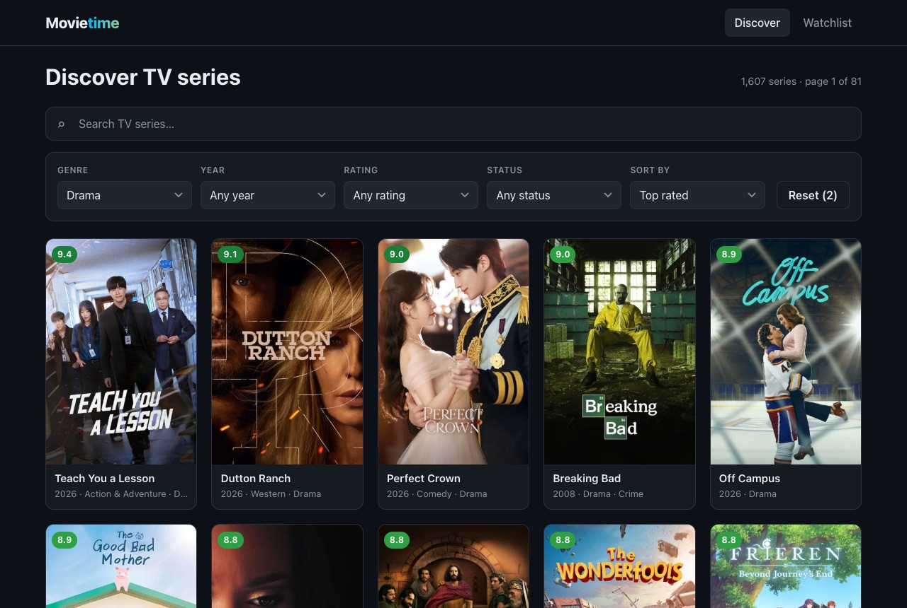
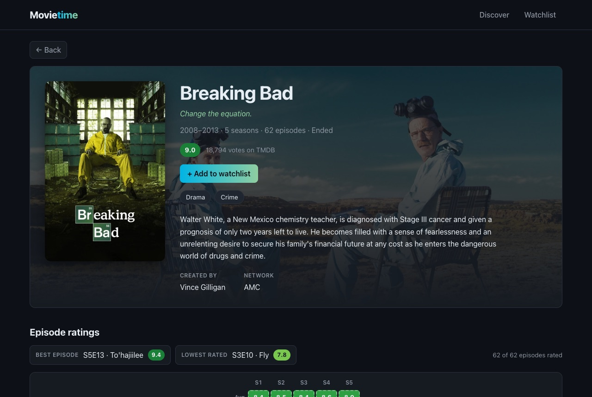
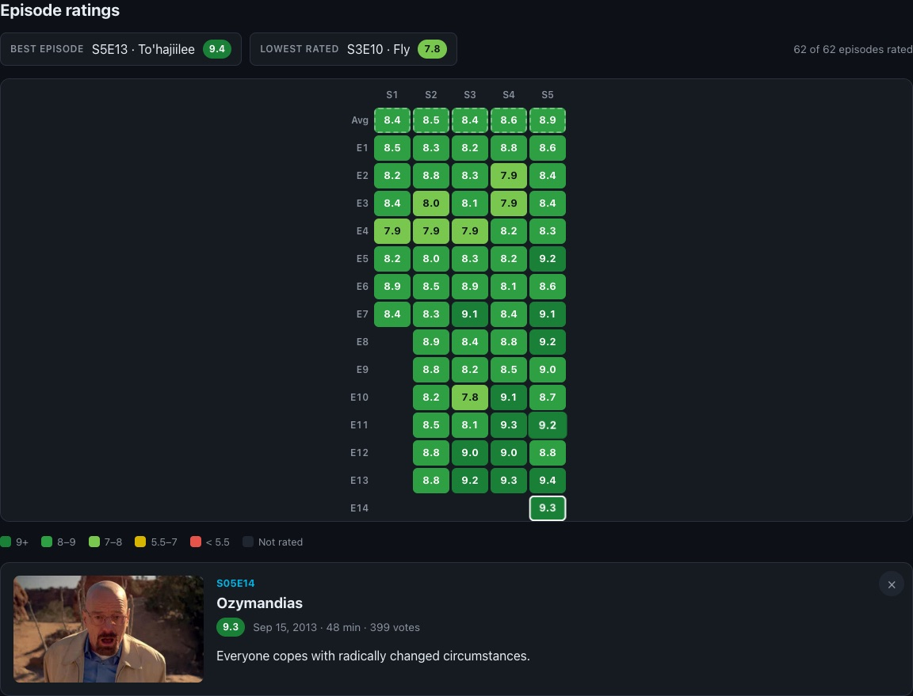
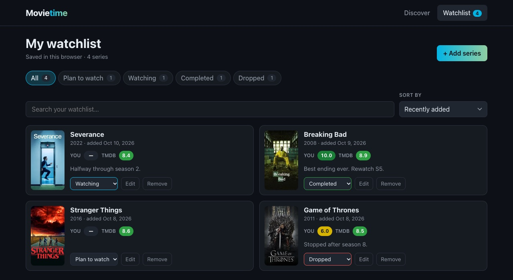
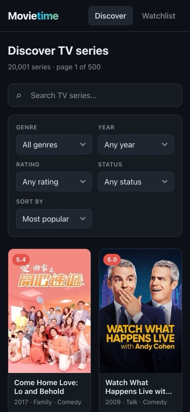

# Movietime

Discover TV series, see how every episode is rated, and keep a personal watchlist.
A React single-page application powered by the [TMDB API](https://developer.themoviedb.org/docs).

**Live demo:** https://react-movietime.vercel.app

> Midterm project — React SPA (KBTU).



## Features

- **Discover**: browse 20,000+ series with filters (genre, first-air year, minimum rating, status),
  five sort orders and pagination. Filters, sort and page live in the URL, so links can be shared
  and back/forward works.
- **Search**: debounced title search with cancellation of outdated requests.
- **Series page**: overview, seasons, trailer, cast and recommendations, loaded in one request.
- **Episode ratings heatmap** (in the style of SeriesGraph): every episode of every season colored
  by its TMDB rating, with season averages, the best and the lowest rated episode, and an
  episode panel with details.
- **Watchlist**: a controlled form to add a series (with TMDB autocomplete), a status, your own
  score and notes. You can edit and remove entries (with undo). The list has its own search,
  status tabs, sorting and pagination. It's saved in `localStorage` and synced across tabs.
- Loading skeletons, error states with retry, empty states for every list, and a responsive
  layout that works on phones and desktops.

| Series page                                     | Episode ratings                                  |
| ----------------------------------------------- | ------------------------------------------------ |
|  |  |

| Watchlist                                    | Mobile                                        |
| -------------------------------------------- | --------------------------------------------- |
|  |  |

## Tech stack

- **React 19** + **Vite**
- **React Router** in declarative mode: routing only. Data is loaded with `useEffect`, not router loaders.
- **CSS Modules** with design tokens in `src/styles/global.css`
- Plain **`fetch`** + custom hooks. I didn't use a data-fetching library on purpose, so loading,
  cleanup and race-condition handling are visible in the code.
- **ESLint** (`eslint-plugin-react-hooks` recommended rules) + **Prettier**

## Getting started

Requirements: Node.js 20+ and a free [TMDB API Read Access Token](https://www.themoviedb.org/settings/api).

```bash
npm install
cp .env.example .env.local   # then paste your token into VITE_TMDB_TOKEN
npm run dev
```

| Script                 | Description                 |
| ---------------------- | --------------------------- |
| `npm run dev`          | Start the dev server        |
| `npm run build`        | Production build to `dist/` |
| `npm run preview`      | Serve the production build  |
| `npm run lint`         | Lint with ESLint            |
| `npm run format`       | Format with Prettier        |
| `npm run format:check` | Check formatting            |

### Environment variables

| Name              | Description                                 |
| ----------------- | ------------------------------------------- |
| `VITE_TMDB_TOKEN` | TMDB API Read Access Token (sent as Bearer) |

`.env.local` is git-ignored. The app has no backend, so the token ends up in the client bundle.
That's acceptable here because TMDB read tokens are read-only and rate-limited. In a real
product the requests would go through a small proxy.

## Project structure

```
src/
├── api/
│   └── tmdb.js               # fetch wrapper, ApiError, endpoint path builders, image URLs
├── components/               # reusable UI, one folder per component (+ CSS Module)
│   ├── EpisodeHeatmap/       # heatmap grid, episode panel, highlights, legend
│   ├── FilterBar/  SearchBar/  SelectField/  StatusTabs/  Pagination/
│   ├── SeriesCard/  SeriesGrid/  SeriesHero/  SeriesDetails/  SeasonList/  CastList/  Trailer/
│   ├── WatchlistForm/  SeriesPicker/  WatchlistItem/  WatchlistButton/
│   └── Button/  RatingBadge/  StatusMessage/  Skeleton/  Section/  Toast/  BackButton/  Layout/
├── context/                  # WatchlistProvider + context object
├── hooks/                    # useFetch, useEpisodeRatings, useSeriesFilters, useWatchlist, ...
├── pages/                    # route components
├── storage/                  # localStorage read/write for the watchlist
├── styles/                   # global styles and design tokens
└── utils/                    # pure helpers: formatting, filter config, sorting
```

## Architecture

### Routes and render tree

| Route                      | Page                | Purpose                                       |
| -------------------------- | ------------------- | --------------------------------------------- |
| `/`                        | `HomePage`          | Discover + search, filters, sort, pagination  |
| `/series/:id`              | `SeriesPage`        | Series details and episode heatmap            |
| `/watchlist`               | `WatchlistPage`     | Personal list with search, tabs, sort, paging |
| `/watchlist/new`           | `WatchlistAddPage`  | Add form (`?series=<id>` preselects a series) |
| `/watchlist/:entryId/edit` | `WatchlistEditPage` | Edit form                                     |
| `*`                        | `NotFoundPage`      | 404                                           |

```
<BrowserRouter>
└── <App>
    └── <WatchlistProvider>                 watchlist state (shared by several routes)
        └── <Layout>                        header, nav with watchlist count, footer
            ├── <HomePage>
            │   ├── <SearchBar>
            │   ├── <FilterBar> → <SelectField> ×5
            │   ├── <SkeletonGrid> | <StatusMessage> | <SeriesGrid> → <SeriesCard> → <RatingBadge>
            │   └── <Pagination>
            ├── <SeriesPage>
            │   └── <SeriesDetails key={id}>
            │       ├── <SeriesHero actions={<WatchlistButton>}>
            │       ├── <EpisodeHeatmap> → <HeatmapGrid>, <EpisodePanel>
            │       ├── <SeasonList>, <Trailer>, <CastList>
            │       └── <SeriesGrid>        recommendations (same component as Discover)
            ├── <WatchlistPage> → <StatusTabs>, <SelectField>, <WatchlistItem>, <Pagination>, <Toast>
            └── <WatchlistAddPage> / <WatchlistEditPage> → <WatchlistForm key=…> → <SeriesPicker>
```

### Where state lives and why

| State                                      | Where                                              | Why                                                                                       |
| ------------------------------------------ | -------------------------------------------------- | ----------------------------------------------------------------------------------------- |
| Discover filters, sort, page, search query | URL search params (`useSeriesFilters`)             | Shareable links, refresh keeps them, back/forward walks through them                      |
| Text typed in the search box               | `useState` in `SearchBar`                          | Changes on every keystroke; only the debounced value is committed to the URL              |
| API responses + request status             | `useState` inside `useFetch` / `useEpisodeRatings` | Each component that needs data owns its request                                           |
| Watchlist entries                          | `useState` in `WatchlistProvider` (context)        | Needed by the series page, the watchlist pages and the nav. Lifted to their common parent |
| Watchlist search, status tab, sort, page   | `useState` in `WatchlistPage`                      | Page-only UI state. Personal data, so there is nothing to share in a URL                  |
| Form values, "submitted" flag              | `useState` in `WatchlistForm`                      | Local to the form until submit                                                            |
| Selected episode in the heatmap            | `useState` in `EpisodeHeatmap` (id only)           | The episode object is derived from loaded data, so it can't go stale                      |
| Trailer playing                            | `useState` in `Trailer`                            | Pure UI state, reset per series by `key`                                                  |

Things that can be computed are **not** stored: filtered/sorted watchlist, total pages,
validation errors, `loading` status, best/worst episode, season averages.

### How API data reaches the UI

```
HomePage
  filters (URL) ──► toDiscoverParams() ──► endpoints.discoverSeries() ──► path string
                                                                          │
                                       useFetch(path) ◄────────────────────┘
                                         └─ useEffect([path, attempt]) → tmdbGet(path, { signal })
  { status, data, error, reload } ◄──────┘
        │
        ├─ loading → <SkeletonGrid>
        ├─ error   → <StatusMessage tone="error"> + "Try again" (reload)
        ├─ empty   → <StatusMessage> with a context-specific action
        └─ success → <SeriesGrid items={data.results} genresById={…}> → <SeriesCard> (props)
```

The data isn't shown as-is. Genre ids are turned into names, unaired episodes are marked as
"not rated" instead of 0, season averages and best/worst episodes are computed, trailers are
picked by priority, specials are moved to the end, and search results can be saved into the
watchlist.

## React concepts in the code

### Effects, dependencies and cleanup

| Effect                                  | Dependencies                      | Cleanup                                |
| --------------------------------------- | --------------------------------- | -------------------------------------- |
| `useFetch`: load a TMDB path            | `[path, attempt]`                 | `controller.abort()` + `ignore = true` |
| `useEpisodeRatings`: load all seasons   | `[seriesId, seasonsKey, attempt]` | aborts every batch with one controller |
| `SearchBar`: debounce commit to the URL | `[value, query]`                  | `clearTimeout`                         |
| `useDebouncedValue`                     | `[value, delay]`                  | `clearTimeout`                         |
| `WatchlistProvider`: persist to storage | `[entries]`                       | none needed                            |
| `WatchlistProvider`: cross-tab sync     | `[]`                              | `removeEventListener('storage')`       |
| `WatchlistPage`: hide undo toast        | `[removed]`                       | `clearTimeout`                         |
| `Layout`: scroll to top on route change | `[pathname]`                      | none needed                            |

- **Stable dependencies.** Effects depend on strings, not on objects or arrays created during
  render. `useFetch` gets a path string. `useEpisodeRatings` turns the season list into
  `seasonNumbers.join(',')`, because a new array every render would re-run the effect forever.
- **No synchronous `setState` in effects.** `loading` isn't stored. Each result is saved together
  with the request key it belongs to, and if that key doesn't match the current request, the
  request is still loading.
- **Stale closures.** The debounce timer in `SearchBar` calls `onSearch` through
  `useEffectEvent`, so it always uses the latest callback without making it a dependency.

### Race conditions

Typing "breaking bad" quickly, or clicking through pages fast, starts requests that can finish
out of order. Every request effect:

1. aborts the previous request through `AbortController` in its cleanup, and
2. sets an `ignore` flag, so a late response is dropped even if it slipped past the abort.

Combined with the 400ms debounce, a fast-typed query sends one request, and the UI always shows
the results for the current query.

### Keys, identity and resetting state

- List keys are stable ids: TMDB `id` for series, `credit_id` for cast (one actor can play
  several roles), `crypto.randomUUID()` for watchlist entries. Indexes are only used where the
  position _is_ the identity (skeleton placeholders, heatmap rows "episode N").
- `<SeriesDetails key={id}>`: going from one series to a recommended one would otherwise reuse
  the component and keep its state, for example a trailer still playing. The key makes React mount
  a fresh instance.
- `<WatchlistForm key={…}>`: the form reads `initialValues` only on mount, so a different entry
  or a preselected series gets its own instance.
- `SearchBar` updates its input during render when the URL query changes from outside (back
  button, clear). This follows React's "adjusting state when a prop changes" pattern instead of
  an effect.

### Events, forms and immutable updates

- Controlled inputs everywhere: search, selects, radio group, textarea, autocomplete.
- Several setters in one handler (`setSearch` + `setPage(1)`) are batched into one re-render.
- Immutable updates: `[entry, ...prev]`, `prev.map(...)`, `prev.filter(...)`,
  `[...prev.slice(0, i), entry, ...prev.slice(i)]`, and `new URLSearchParams(prev)` for the URL.
- No direct DOM manipulation. The page `<title>` is rendered as JSX (React 19 hoists it into
  `<head>`). `window.scrollTo` and the `storage` listener are calls to browser APIs from effects
  and handlers.

## TMDB limitations and how they are handled

| Limitation                                                   | Handling                                                               |
| ------------------------------------------------------------ | ---------------------------------------------------------------------- |
| `/search/tv` can't filter by genre/rating/status or sort     | Search mode disables those controls and explains why. Year still works |
| `total_pages` can be 1000+, but pages above 500 return 400   | Pages are capped at 500, also when they come from the URL              |
| "Top rated" is dominated by shows with one 10/10 vote        | Rating sort and the rating filter require a minimum number of votes    |
| Discover "newest" includes announced shows dated years ahead | Newest sort is capped at today                                         |
| `append_to_response` accepts at most 20 sub-requests         | Seasons are split into batches of 20 and loaded with `Promise.all`     |
| Unaired episodes have rating `0`                             | Shown as "not rated", not as a bad score                               |

## Deployment

Deployed on **Vercel** from the `main` branch: https://react-movietime.vercel.app

- `vercel.json` rewrites every path to `index.html`, so deep links like `/series/1396` work on
  refresh.
- `VITE_TMDB_TOKEN` is set in the Vercel project's environment variables.

## Credits

This product uses the TMDB API but is not endorsed or certified by TMDB. Series data and images
© [The Movie Database](https://www.themoviedb.org/).
