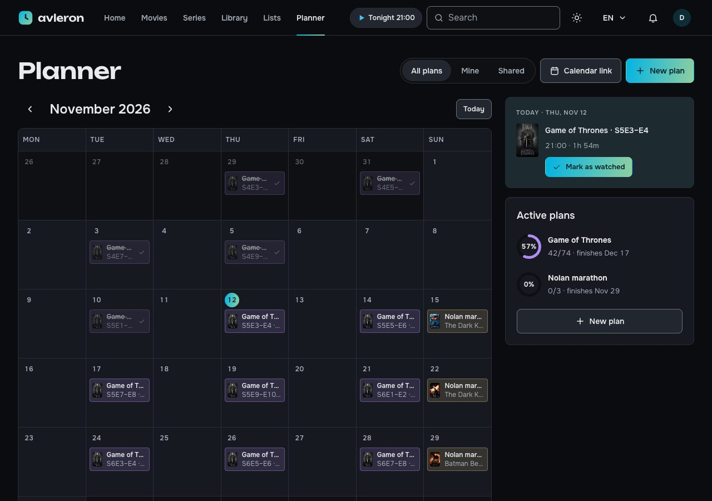
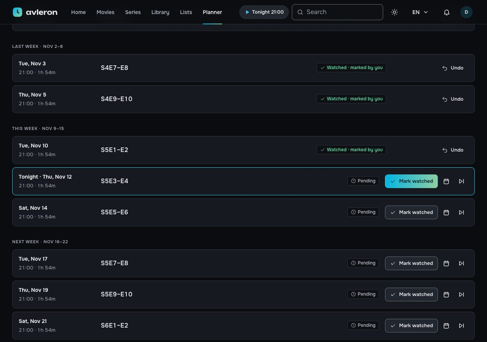
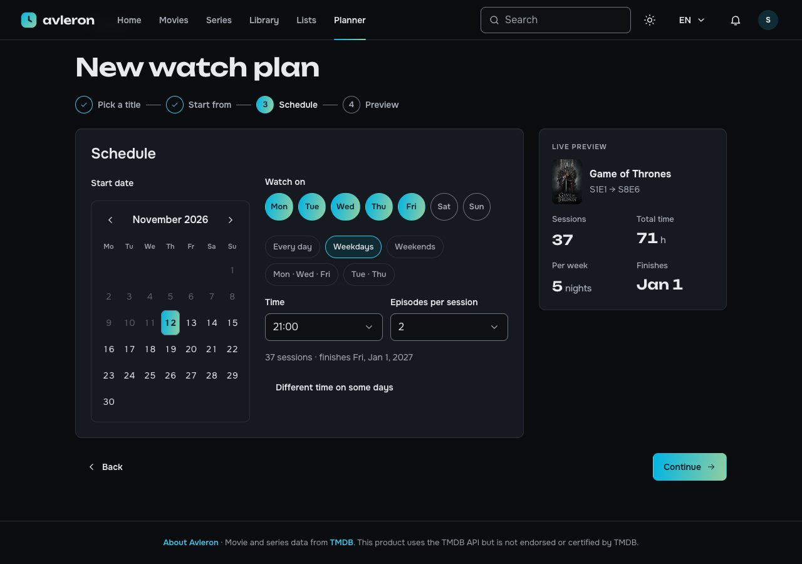
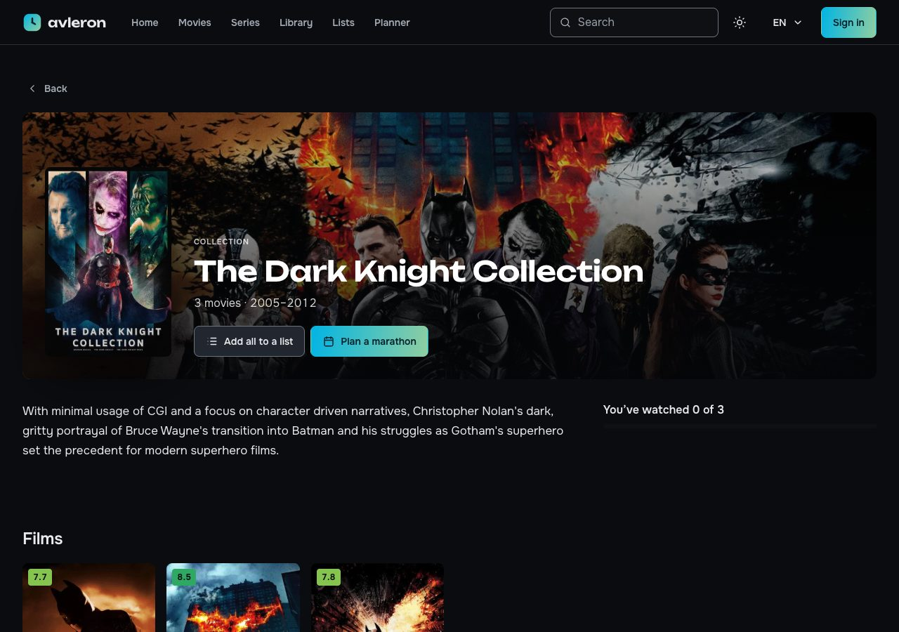
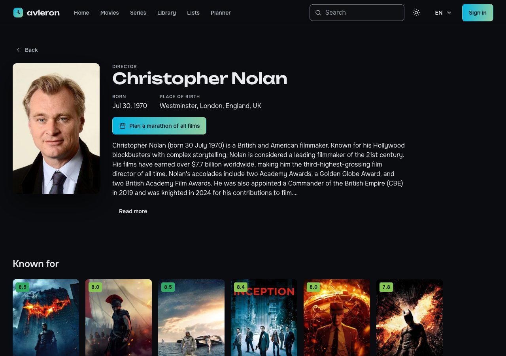
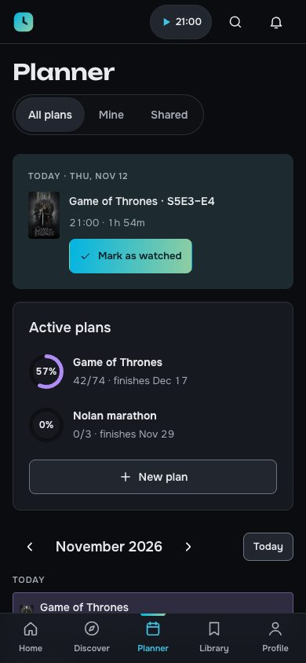

# Movietime

[](https://github.com/EraEKV/react_movietime/actions/workflows/ci.yml)

Plan what to watch, and watch it together.

Movietime (the product is called **Avleron**) is a React single-page application for movies and
TV series. You discover titles from [TMDB](https://developer.themoviedb.org/docs), see how every
episode of a series is rated, keep a personal library, collect titles into lists, and turn a
series, a film, a franchise or a director's filmography into a **watch schedule** on a
calendar. Lists and schedules can be shared with friends by link or with an editor / viewer
role, and a shared movie marathon lets friends like and suggest films.

**Live demo:** https://avleron.com

> React end-term project (KBTU), built on top of the midterm version.
> **Status:** all planned features are implemented, deployed and covered by tests; see the
> [roadmap](docs/PROJECT_PLAN.md#5-roadmap). The site runs on Cloudflare Workers; how it is
> protected from bots and scrapers is in [docs/PROTECTION.md](docs/PROTECTION.md).


## Features

### Catalog

- ✅ **Movies and series catalogs** (one page, switched by a Movies/Series control) with
  server-side search (debounced), five filters (genre, year, minimum rating, original language,
  plus runtime for movies or status for series), five sort orders, pagination and a page size of
  20 / 40 / 60. Everything lives in the URL, so links can be shared and back/forward works.
- ✅ **Where to watch** on movie and series pages: official services by country (subscription,
  free, with ads, rent, buy) from TMDB `/watch/providers`, credited to JustWatch as TMDB asks.
  The country follows the interface language and the choice is remembered on the device. The
  app only points to services and plays nothing itself.
- ✅ **Series page**: overview, seasons, trailer, cast and recommendations.
- ✅ **Episode ratings heatmap**: every episode of every season colored by its TMDB rating,
  with season averages, best and lowest episode, and an episode panel.
- ✅ **Movie page**: overview, director, budget, revenue, runtime, release date, trailer, cast,
  full crew by department and recommendations. Series and movie pages share a hero with the
  backdrop, genre chips, rating and the library / planner actions.
- ✅ **People and franchises**: a person page (biography, filmography with filters) can start a
  marathon of that director's films; a collection page (a franchise such as The Dark Knight)
  lists its films, shows where you stopped and plans the whole marathon in one step.

### Personal data

- ✅ **Authentication**: email/password with validation and email verification, Google
  sign-in, persistent session, protected routes.
- ✅ **Library** (the midterm watchlist, now for movies and series): status, score 1–10, notes
  and episode progress for each title; status tabs with counts, search, type, genre and sort in
  the URL, rows or poster grid, undo for changes and removals. Guests keep it in `localStorage`
  (synced across tabs), signed-in users in Firestore in real time. On sign-in the guest library
  is merged into the account, and the midterm watchlist is moved into it once.
- ✅ **Lists**: named collections of movies and series with an emoji cover and a poster
  collage; create, rename, delete with confirm; add titles from a search picker, from a title
  page or a catalog card; per-title notes; remove with undo. Stored in Firestore, live.
- ✅ **Sharing**: share a list by link (read-only, works for guests) or add friends by email
  as **editor** or **viewer**; change roles, remove access with undo, leave a list, copy a
  shared list to your own. "Shared with me" on the Lists and Home pages. Access is enforced by
  Firestore security rules (member access needs a verified email). Plans are shared the same
  way.
- ✅ **Watch Planner**: turn a series (from your last watched episode, the start or any
  episode), one film, a list, a franchise or a director's filmography into viewing sessions.
  Pick the start date, the weekdays (one-tap presets: every day, weekdays, weekends, Mon·Wed·Fri,
  Tue·Thu), the usual time and an own time for some days, and see a live preview with the number
  of sessions, hours and the finish date. In the preview you can drag a session to another day,
  change its time, leave a film out or reorder films; evenings that overlap your other plans are
  flagged. A month calendar (agenda on phones), "Today" with _Mark as watched_, plans by week
  with mark / reschedule (optionally shifting later sessions) / skip / undo, and a banner that
  offers to continue from today when you fall behind. `.ics` export and a secret calendar link,
  sharing with editors and viewers, owner rename. Marking a session moves your library progress
  and completes the title on the last one. "Up next" on Home and a "Tonight" chip in the header.
- ✅ **Shared movie marathons**: viewers of a list plan like films and suggest another film for an
  evening; the owner accepts it or replaces the film, and everyone involved gets a notification.
- ✅ **Dashboard**: statistic tiles with animated numbers (titles, completed, average score,
  hours watched, sessions this week, active plans) and charts built with Recharts: titles by
  status and movies vs series as rings with a tooltip, top genres, sessions by weekday, active
  plans as progress bars, a graph of the last twelve weeks and a month activity grid with month
  switching. The period is all time, 30 days or this year (`?period=`). Tiles and bars open the
  library with the same filter; upcoming sessions open their plan. Works for guests from the
  local library.
- ✅ **Invitations and notifications**: when an owner adds someone to a list or plan, that
  person gets a bell notification (unread counter, live) with _Open_, _Mark as read_ and
  _Decline_ (leave). For people who may not have an account, the share dialog gives an invite
  link (copy, the phone's share sheet, or a prefilled email) that opens sign-up with the email
  filled in and then the list or plan, or can be emailed from the dialog (Resend, a Worker
  endpoint in `api/`). A role change is emailed to the member as well, and a new account gets
  a one-time welcome email. Push notifications (Settings → Notifications, Web Push) tell a friend
  about a share or a role change even when the app is closed. The app never checks whether an
  account exists: the notification waits for the verified email.
- ✅ **Calendar link**: Settings → Calendar creates one secret address with every session of all
  your plans (and plans shared with you). Paste it into Google Calendar (Other calendars → From
  URL); an endpoint in `api/` serves it, and a new link cancels the old one.
- ✅ **Profile**: account info, counters and an activity feed; settings for display name, avatar
  (an emoji on a colour, or your own photo cropped in the app and stored in the profile, with no
  file storage), theme and language.
- ✅ **Languages**: English, Русский, Қазақша from the header menu or the settings. The choice is
  saved in the account, applies without a reload and is sent to TMDB (`language=ru-RU`), so
  titles and overviews are translated too.

### App

- ✅ Loading skeletons, error states with retry, empty states, responsive layout. On phones the
  header keeps four items for a signed-in user (logo, Tonight, search, notifications); theme,
  language and the account are in Profile → Settings, and the main navigation is a bottom tab bar.
- ✅ **Protection against bots and scrapers**: a TMDB proxy that answers only what the app asks,
  an edge cache, capped and authenticated endpoints, long-lived static caching and rate limit
  and challenge rules in Cloudflare (see [docs/PROTECTION.md](docs/PROTECTION.md)).
- ✅ Light / dark theme that follows the system by default, with a toggle in the header.
- ✅ **Installable PWA with offline support**: own Workbox service worker, precached app shell,
  cached TMDB responses and images, an offline pill and an update prompt (see
  [PWA notes](#pwa-notes)).
- ✅ **Tests**: 527 unit and component tests in 75 files with Vitest and React Testing Library.

## Screenshots

Both themes follow the system setting and can be switched in the header. The screenshots are
taken on a local build with demo data.

| Dark                                                   | Light                                                    |
| ------------------------------------------------------ | -------------------------------------------------------- |
|   |   |
|  |  |

| Episode ratings                                  | Library                                  | Dashboard                                    |
| ------------------------------------------------ | ---------------------------------------- | -------------------------------------------- |
|  |  |  |

Planner: the month calendar with two plans, a plan page with tonight's session, and the schedule
step with the weekday presets and the finish date.

| Calendar                                          | Plan                                    | Schedule step                                   |
| ------------------------------------------------- | --------------------------------------- | ----------------------------------------------- |
|  |  |  |

| Franchise                                           | Person                                      |
| --------------------------------------------------- | ------------------------------------------- |
|  |  |

On phones the main navigation is a bottom tab bar and the header keeps four items for a
signed-in user (logo, Tonight, search, notifications).

| Mobile, dark                                                                | Mobile, light                                                                 | Mobile planner, signed in                                                        |
| --------------------------------------------------------------------------- | ----------------------------------------------------------------------------- | -------------------------------------------------------------------------------- |
|  |  |  |

## Tech stack

- **React 19** + **TypeScript** (strict) + **Vite**, **React Router** (declarative mode)
- **Redux Toolkit**: global state (`preferences`, `auth`, `library`) with listener middleware
- **Firebase**: Authentication (email/password, Google), Cloud Firestore
- **TMDB API** for movies and series, through our own proxy (token on the server, allow-list, edge cache)
- **Cloudflare Workers** (`wrangler.jsonc`, `worker/index.ts`): static assets, the `/api/*` endpoints
  (TMDB proxy, mail through Resend, Web Push, calendar feed) and the Firebase sign-in proxy `/__/*`
- **Recharts** and **@number-flow/react** for the dashboard, **@dnd-kit** for drag and drop (reorder
  films, move a session in the preview)
- **CSS Modules** on design tokens (`shared/styles/tokens.css`), dark and light themes via `data-theme`
- Fonts Onest and Unbounded are self-hosted (`@fontsource-variable`)
- Plain `fetch` + custom hooks for TMDB, `onSnapshot` + custom hooks for Firestore
- `i18next` + `react-i18next`: en / ru / kk, dictionaries are JSON files in `public/locales/`, split by feature and loaded on demand
- **Service worker** written with Workbox (`vite-plugin-pwa`, `injectManifest` mode)
- **Vitest** + **React Testing Library**
- **ESLint** (`typescript-eslint`) + **Prettier**

## Getting started

Requirements: Node.js 24 (`.nvmrc`), a free
[TMDB API Read Access Token](https://www.themoviedb.org/settings/api) and a Firebase project
(see [docs/FIREBASE_SETUP.md](docs/FIREBASE_SETUP.md)).

```bash
git clone https://github.com/EraEKV/react_movietime.git
cd react_movietime
npm install
cp .env.example .env.local   # fill in the values, see below
npm run dev
```

| Script                  | Description                                  |
| ----------------------- | -------------------------------------------- |
| `npm run dev`           | Start the dev server                         |
| `npm run build`         | Type-check, then production build to `dist/` |
| `npm run typecheck`     | Type-check with `tsc -b`                     |
| `npm run preview`       | Serve the production build                   |
| `npm run lint`          | Lint with ESLint                             |
| `npm run format`        | Format with Prettier                         |
| `npm run format:check`  | Check formatting                             |
| `npm test`              | Run all tests once (Vitest)                  |
| `npm run test:watch`    | Run tests in watch mode                      |
| `npm run check:locales` | Check that en / ru / kk dictionaries match   |
| `npm run emulators`     | Local Firebase emulators (needs Java 21)     |

### Tests

```bash
npm test             # run once, as in CI
npm run test:watch   # re-run on change
```

527 tests in 75 files: pure logic (schedule, previews, stats, filters, validation, catalog paging,
the TMDB proxy allow-list, the edge cache), Redux slices, hooks (`useFetch`,
`useDebouncedValue`), server handlers (mail, push, calendar feed) and components (pagination,
signup validation, protected routes, the schedule step, session rows, and others). Vitest runs in
`jsdom`; `src/test/setup.ts` loads the real English dictionaries from `public/locales` and
stubs `matchMedia`. Tests need no network, no Firebase and no environment variables. Firestore
security rules were checked separately against the emulator (not part of `npm test`).

### Continuous integration

GitHub Actions (`.github/workflows/ci.yml`) runs on every push and on pull requests to `main`,
on Node 24 (`.nvmrc`). It needs no secrets: the build works without `VITE_*` values, the
host injects them for the real deployment. Steps, in order:

1. `npm ci`
2. `npm run typecheck`
3. `npm run lint`
4. Prettier check over all tracked files
5. `npm run check:locales` (en, ru and kk dictionaries have the same keys)
6. `npm run test:coverage` (Vitest with the v8 coverage report)
7. `npm run build`

The coverage report is uploaded as the `coverage` artifact of the run. `npm audit` reports
high-severity advisories but does not fail the run. Dependencies are updated by hand.

### Local Firebase emulators (optional)

`npm run emulators` starts the Auth and Firestore emulators (Firestore on port 8180, needs
Java 21). With `VITE_USE_EMULATORS=true npm run dev` the app talks to them instead of the real
project, which is handy for trying security rules without touching production data.

### Environment variables

| Name                                                          | Required | Description                                                |
| ------------------------------------------------------------- | :------: | ---------------------------------------------------------- |
| `TMDB_TOKEN`                                                  |   yes    | TMDB read access token, server only (secret)               |
| `SITE_URL`                                                    |   yes    | Address of the app, used in email and calendar links       |
| `VITE_FIREBASE_API_KEY`                                       |   yes    | Firebase web app config                                    |
| `VITE_FIREBASE_AUTH_DOMAIN`                                   |   yes    | `<project-id>.firebaseapp.com` (off the production domain) |
| `VITE_FIREBASE_PROJECT_ID`                                    |   yes    |                                                            |
| `VITE_FIREBASE_STORAGE_BUCKET`                                |   yes    |                                                            |
| `VITE_FIREBASE_MESSAGING_SENDER_ID`                           |   yes    |                                                            |
| `VITE_FIREBASE_APP_ID`                                        |   yes    |                                                            |
| `VITE_FIREBASE_MEASUREMENT_ID`                                |    no    | Only for Google Analytics, not used by the app             |
| `VITE_USE_EMULATORS`                                          |    no    | `true` connects to the local emulators (dev)               |
| `RESEND_API_KEY`, `RESEND_FROM`                               |    no    | Invite, role-change and welcome emails (secret)            |
| `VITE_VAPID_PUBLIC_KEY`, `VAPID_PRIVATE_KEY`, `VAPID_SUBJECT` |    no    | Web Push keys (the private key is a secret)                |
| `FIREBASE_SERVICE_ACCOUNT`                                    |    no    | Firebase Admin JSON for the push endpoints (secret)        |
| `FIREBASE_AUTH_HOST`                                          |   prod   | Host that `/__/*` is proxied to (set in `wrangler.jsonc`)  |

`.env.local` is git-ignored. All of these values end up in the client bundle, which is
expected: the Firebase web config only identifies the project, and user data is protected by
Firestore security rules. Secrets (the TMDB token, the Resend key, the VAPID private key, the
service account) are not `VITE_` variables: they are read only by the Worker (or by
`vite.dev-api.ts` in development), so they never reach the browser.

## API documentation

Full reference: **[docs/API.md](docs/API.md)** (service functions) and
**[docs/DATA_MODEL.md](docs/DATA_MODEL.md)** (schemas, security rules, indexes).

### Resources

| Resource                | Backend                                   | Operations                                                                   |
| ----------------------- | ----------------------------------------- | ---------------------------------------------------------------------------- |
| Titles (movies, series) | TMDB REST                                 | List with search, filters, sort, paging; details by id; seasons and episodes |
| Library entries         | Firestore `users/{uid}/library`           | Create, read, update, delete (owner only)                                    |
| Lists + items           | Firestore `lists`, `lists/{id}/items`     | Full CRUD; shared by link or roles                                           |
| Plans + sessions        | Firestore `plans`, `plans/{id}/sessions`  | Generate, complete, reschedule, skip, reorder films, delete                  |
| Film suggestions, likes | Firestore `plans/{id}/proposals`, `likes` | Create (viewers), accept or replace (owner), like                            |
| Profile, activity       | Firestore `users/{uid}`                   | Read, update (display name, avatar, calendar token)                          |
| Notifications           | Firestore `notifications`                 | Create (owner, with the invite), read, mark read, delete (recipient)         |

### TMDB endpoints

| Endpoint                                                                                                | Used for                |
| ------------------------------------------------------------------------------------------------------- | ----------------------- |
| `GET /discover/tv`, `GET /discover/movie`                                                               | Catalogs                |
| `GET /search/tv`, `GET /search/movie`                                                                   | Search                  |
| `GET /tv/{id}`, `GET /movie/{id}` + `append_to_response=credits,videos,recommendations,watch/providers` | Details, where to watch |
| `GET /tv/{id}?append_to_response=season/1,…`                                                            | Heatmap, planner        |
| `GET /genre/{tv,movie}/list`, `GET /trending/{tv,movie}/week`                                           | Filters, home page      |
| `GET /person/{id}`, `GET /collection/{id}`, `GET /search/person`, `GET /search/collection`              | People and franchises   |

The browser never calls TMDB: every request goes to `/api/tmdb/*` on our domain, where the
Worker checks it against an allow-list, adds the token and caches the answer
([docs/PROTECTION.md](docs/PROTECTION.md)).

### App URL parameters (catalog)

`/movies` and `/series` accept `q`, `genre`, `year`, `rating`, `lang`, `status` (series),
`runtime` (movies), `sort`, `page` and `size`. Invalid values fall back to defaults. Details:
[DATA_MODEL.md → Catalog query parameters](docs/DATA_MODEL.md#catalog-query-parameters-app-url--tmdb).

## PWA notes

- **Install:** open the deployed site in Chrome or Edge and use the install icon in the address
  bar, or "Add to Home Screen" on Android and iOS. The manifest has 192/512 and maskable icons.
- **Offline:** the app shell is precached (15 files) and every other chunk and dictionary is
  cached the first time it is used, so the app opens and routes without a network once a page
  has been visited. TMDB responses use network-first (the last response is
  shown offline), poster images use cache-first, and Firestore keeps user data in its persistent
  cache and queues writes. An "Offline" pill appears in the header; `/offline` is the fallback
  page for a navigation that nothing can serve.
- **Updates:** a new build installs in the background; the user sees the toast "A new version
  of Movietime is ready" and the app reloads on "Reload". Until then the old version keeps working.
- The service worker is plain Workbox code in [`src/sw.ts`](src/sw.ts); `vite-plugin-pwa` only
  injects the precache manifest (`injectManifest`). It is registered in production builds only.

## Routes

| Route                                     | Page              | Access                    |
| ----------------------------------------- | ----------------- | ------------------------- |
| `/`                                       | Home              | public                    |
| `/about`                                  | About             | public                    |
| `/login`, `/signup`                       | Login, Signup     | guests only               |
| `/movies`, `/series`                      | Catalog           | public                    |
| `/movies/:id`, `/series/:id`              | Title details     | public                    |
| `/person/:id`, `/collection/:id`          | Person, franchise | public                    |
| `/verify-email`                           | Verify email      | signed in, not verified   |
| `/library`, `/library/:key/edit`          | Library           | public (local for guests) |
| `/lists`, `/lists/new`, `/lists/:id/edit` | Lists management  | signed in                 |
| `/lists/:id`                              | List              | owner, members, link      |
| `/planner`, `/planner/new`                | Planner           | signed in                 |
| `/planner/:id`                            | Plan              | owner, members, link      |
| `/dashboard`                              | Dashboard         | public (local for guests) |
| `/profile`, `/profile/settings`           | Profile           | signed in                 |
| `/offline`                                | Offline           | public                    |
| `*`                                       | Not found         | public                    |

An invite link, `/signup?invite=lists/<id>&email=<email>`, prefills the email and, after
sign-up and email verification, opens that list (`plans/<id>` opens the plan).

## Project structure

```
src/
├── shared/       code with no business meaning, imports nothing from the rest of src
│   ├── ui/       UI kit: Button, Dialog, Menu, Field, Tabs, Toast, Skeleton, …
│   ├── hooks/    useFetch, useRequest, useSubscription, useDebouncedValue, useMediaQuery, …
│   ├── lib/      cx, format, relativeTime, validation, rovingFocus, rating, …
│   ├── api/      TMDB client and endpoint builders
│   ├── i18n/     i18next setup, typed keys, Intl helpers
│   ├── styles/   global styles, design tokens, themes
│   └── types/    app-wide types (Option, Language, Theme)
├── components/   app components: layout, catalog, library, lists, planner, dashboard, …
├── pages/        one file per route
├── hooks/        hooks with app data: auth, library, lists, planner, sharing, …
├── services/     Firebase: auth, profile, library, lists, sharing, notifications, planner
├── storage/      localStorage modules
├── store/        Redux store, slices, typed hooks
├── types/        TypeScript types for TMDB responses and app data
├── utils/        pure domain helpers: filters, schedule, stats, sharing, …
├── test/         Vitest setup (tests live next to the code as *.test.ts[x])
└── sw.ts         service worker (Workbox)
```

`src/shared` must not import from the rest of `src`; an ESLint `no-restricted-imports` rule
enforces it.

How it fits together, where each piece of state lives and why, and the React patterns used
(effects and cleanup, race conditions, keys): **[docs/ARCHITECTURE.md](docs/ARCHITECTURE.md)**.

## Documentation

| Document                                    | Content                                                   |
| ------------------------------------------- | --------------------------------------------------------- |
| [PROJECT_PLAN.md](docs/PROJECT_PLAN.md)     | Features, roadmap, requirements checklist                 |
| [ARCHITECTURE.md](docs/ARCHITECTURE.md)     | Folder structure, routing, state, caching, React patterns |
| [API.md](docs/API.md)                       | Service modules, hooks                                    |
| [DATA_MODEL.md](docs/DATA_MODEL.md)         | TMDB resources, Firestore schema, security rules          |
| [FIREBASE_SETUP.md](docs/FIREBASE_SETUP.md) | Configuring Firebase, Cloudflare, mail and push           |
| [PROTECTION.md](docs/PROTECTION.md)         | Protection against bots and scrapers                      |
| [CONTRIBUTING.md](docs/CONTRIBUTING.md)     | Branches and commit conventions                           |

## Deployment

Deployed on **Cloudflare Workers** from `main`: https://avleron.com

- `wrangler.jsonc` points at the built `dist/` as static assets, with the single-page fallback
  (`not_found_handling`), so deep links work on refresh. Only `/api/*` and `/__/*` run code
  (`run_worker_first`, `worker/index.ts`); everything else is served by Cloudflare itself.
- Plain settings are `vars` in `wrangler.jsonc`; secrets (`TMDB_TOKEN`, `RESEND_API_KEY`,
  `VAPID_PRIVATE_KEY`, `FIREBASE_SERVICE_ACCOUNT`) are set in the Cloudflare dashboard, because a
  deploy replaces any variable set there.
- `public/_headers` sets the cache lifetimes of the static files.
- Firebase (Auth + Firestore) is a hosted backend. `/__/*` is proxied to it so that Google
  sign-in works on our own domain. Firestore rules and indexes are deployed by hand from an
  up-to-date `main` (`firebase deploy --only firestore`).
- `vercel.json` is left from the earlier Vercel hosting and is not used any more.

## Credits

This product uses the TMDB API but is not endorsed or certified by TMDB. Movie and series data
and images © [The Movie Database](https://www.themoviedb.org/).
